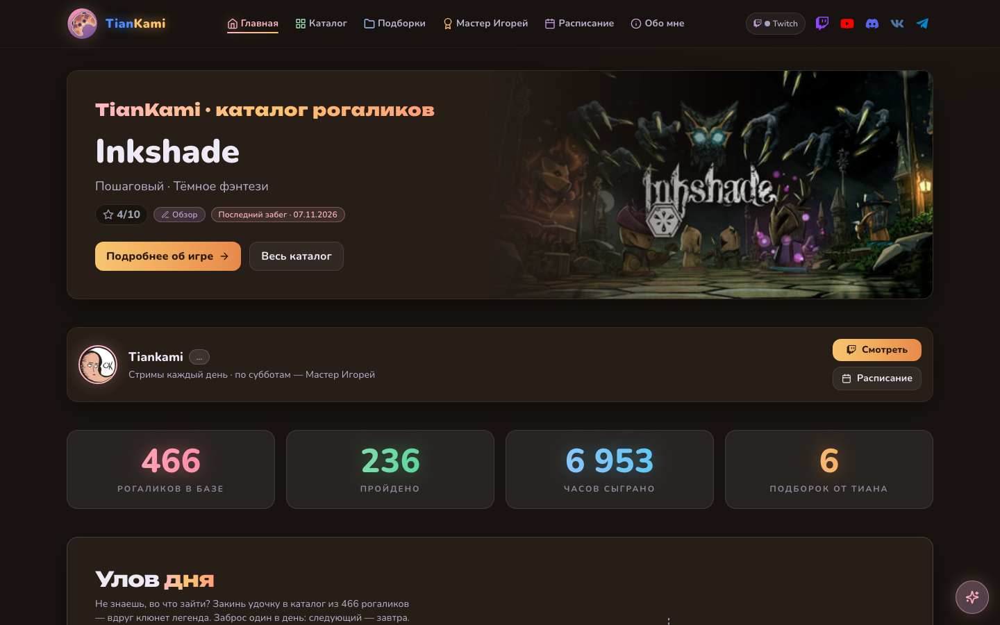
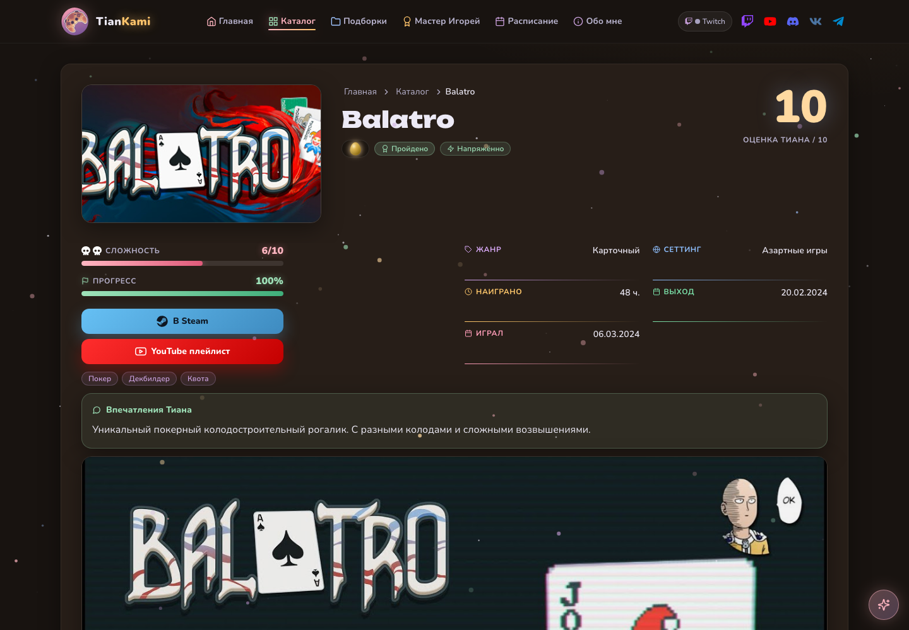
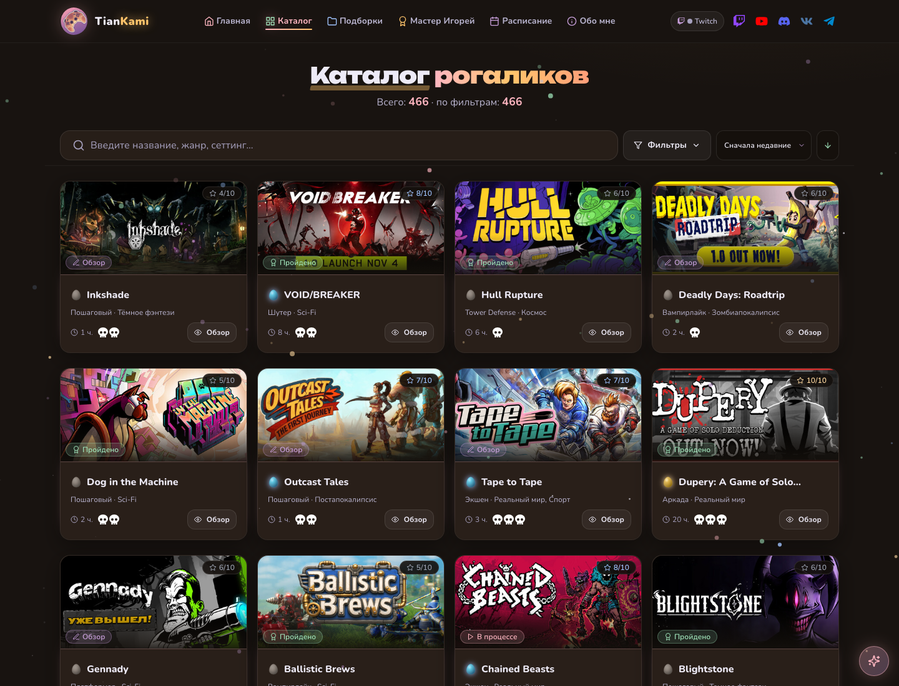
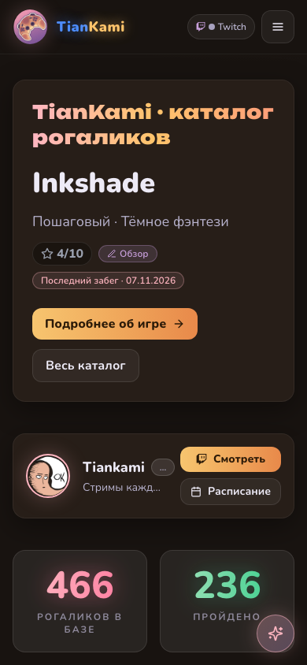

# 🥐 TianKami — каталог рогаликов

[](https://github.com/Gerlod-os/tiankami/actions/workflows/deploy.yml)

Сайт-каталог рогаликов Twitch-канала **Tiankami**: 466 игр с оценками, часами, статусами
прохождений, подборками и расписанием стримов. Каждая страница — готовый HTML, а не пустой
каркас: ссылку на любую игру можно отправить и открыть с телефона.

**Живой сайт:** https://gerlod-os.github.io/tiankami



| Страница игры | Каталог с фильтрами | Мобильная версия |
| :---: | :---: | :---: |
|  |  |  |

## Что внутри

- **Каталог** — поиск и фильтры по жанру, статусу, оценке, сложности, часам и году.
  Выборка живёт в адресе: ссылку на отфильтрованный список можно переслать.
- **Страница игры** — оценка, шкалы сложности и прогресса, метаданные, впечатления
  и запись прохождения. Плеер YouTube грузится по клику: автозагрузка тянула 1,2 МБ
  на каждую страницу.
- **Подборки** — золотой список и тематические топы, собранные вручную.
- **Расписание** — ближайший стрим из календаря Twitch и прошедшие трансляции с записями.
- **Мелочи для настроения** — «Улов дня» (один заброс в сутки), редкость игр пятью
  драконьими яйцами, черепа сложности, соревнование «Мастер Игорей».

## Стек

React 19 · Vite 8 · Tailwind CSS 3.4 · react-router 7 · prerender через SSR ·
vitest и oxlint · GitHub Pages и GitHub Actions.

## Быстрый старт

```bash
npm install
npm run dev          # http://localhost:5173
```

## Сборка

```bash
npm run build        # данные из таблицы → vite build → пререндер ~470 страниц
npm run build:fast   # без обновления данных
npm run preview      # локальная проверка собранного dist/
```

Пререндер отдаёт готовый HTML каждой игры и подборки с уникальными `title`, `description`,
`og:image` и `canonical`, плюс `sitemap.xml` и `robots.txt`.

## Проверки

```bash
npm run lint        # oxlint
npm test            # vitest, 152 теста
npm run test:data   # формат и полнота данных
npm run test:links  # битые внутренние ссылки по собранному dist/
npm run audit       # LCP/CLS, битые картинки, тап-таргеты, ошибки консоли
```

## Деплой

Пуш в `main` запускает `.github/workflows/deploy.yml`: установка зависимостей, сборка,
выкладка `dist` на GitHub Pages. Плюс суточная пересборка, чтобы данные подтягивались
без пуша. Адрес сайта задан в одном месте — `src/config/site.js`.

## Структура

```
src/
  components/   карточки, окно быстрого просмотра, плеер, виджеты Twitch
  config/       брендинг, источник данных, адрес сайта
  data/         игры, подборки, расписание (генерируются синком)
  pages/        главная, каталог, игра, подборки, расписание, «Обо мне»
  utils/        нормализация, даты, рейтинги, редкость, JSON-LD
scripts/        синк данных, пререндер, обложки, проверки, аудит
```

## Лицензия

Код — MIT, см. `LICENSE`. Обложки игр, логотипы и названия принадлежат их правообладателям,
тексты оценок и заметок — каналу Tiankami. Лицензия на код их не покрывает.
